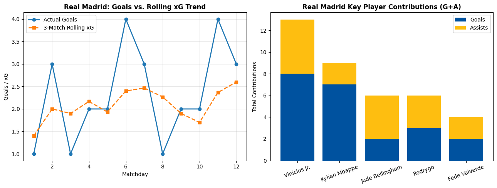

# AI in Soccer Analysis: Trend & Performance Tracker

A zero-dependency, online-compiler-friendly Python program designed to analyze soccer team performance trends over time. 

By utilizing pure Python built-in features, this script requires zero external libraries (like NumPy, Pandas, or SciPy), making it completely lightweight and ready to run out of the box in any environment.

## 🚀 Key Features
* **Zero Dependencies:** Runs flawlessly on standard Python 3 installations or online Python compilers.
* **Rolling Window Averages:** Computes a configurable moving average (default: last 3 matches) to smooth out match-to-match volatility.
* **Least-Squares Regression:** Uses custom linear algebra implementations to compute exact trend lines and slopes for team progression.
* **Comprehensive Metrics:** Tracks progression across critical football analytics benchmarks:
  * Points (Form)
  * Realized Goal Difference
  * Expected Goals (xG) Difference
  * Passing Accuracy percentages

## 📋 Sample Output
When executed, the program processes your matchday records and generates a clean text report:

```text
=== Soccer Trend Summary (Online Compiler Version) ===
Matches analyzed: 12
Rolling window: last 3 matches

Points          : upward   trend | slope = 0.0524 pts/matchday
Goal Difference : upward   trend | slope = 0.0612 goals/matchday
xG Difference   : upward   trend | slope = 0.0490 xG/matchday
Pass Accuracy   : upward   trend | slope = 0.5874 %/matchday

Recent form (last rolling values):
- Avg points:        1.67
- Avg goal diff:     1.00
- Avg xG diff:       1.13
- Avg pass accuracy: 86.00%
```

## 🛠️ How To Run
Simply execute the Python file via your terminal:
```bash
 soccer_analysis.py
```
---

## ⚽ Real Madrid Case Study: Player Stats, Visualizations & ML Predictor (`Real_Madrid_AI_Analytics.ipynb`)
Expanding beyond the zero-dependency trend script (`soccer_analysis.py`), this module applies **Pandas**, **Matplotlib**, and **Scikit-Learn** to a 12-match **Real Madrid** performance dataset:

* **Visual Trend Tracking:** Plots actual goals scored against a 3-match rolling Expected Goals (`xG`) curve alongside stacked attacking contributions (`Goals + Assists`) for **Vinícius Júnior (13 G+A), Kylian Mbappé (9 G+A), Jude Bellingham (6 G+A), Rodrygo (6 G+A), and Federico Valverde (4 G+A)**.
* **Machine Learning Win Classifier & Baseline Evaluation:** Trains a `LogisticRegression` model on Expected Goals (`xG`) and passing accuracy (`75.0%` validation accuracy across high-win-rate fixtures) to benchmark predictive modeling against a majority-class baseline.


